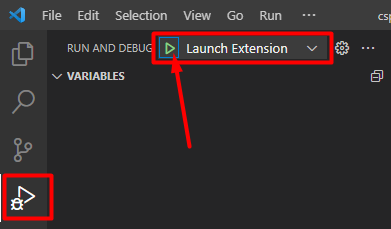

# Contributing

Contributions are very welcome.

Same steps works on Windows (powershell) and Linux. Just needs Node.js installed.

## How to create a new extension

Please fork this repository to add new dictionaries, then follow [Create an extension](./extension-runtime/README.md#create-an-extension).

## Synced extensions

Extensions with an `extension.config.json` are maintained centrally; the two without one, hunspell-syntax and timestamp-hover, are maintained by hand. To change a synced extension, edit its `extension.config.json` or the shared files, then run `npm run sync:extensions` and commit the result. [What the sync maintains](./extension-runtime/README.md#what-the-sync-maintains) lists the files it writes.

### Pre-release mode

While an extension's `package.json` has `"vsce": { "preRelease": true }`, every release of it is published as a pre-release. The " 👀 Set Prerelease" workflow opens a PR that turns the mode on or off for one extension. Turning it off is a `fix:` commit, so the next release is a stable version above the pre-releases.

## Licenses

Note: the preferred licenses are either MIT or GPL3.

The safest to use is GPL3, but it is the most sticky.

Since these extensions bundle the dictionary as part of the extension (falls under static linking clauses), the license must match the bundled dictionary / dictionaries.
If the bundled dictionary is GPL3, then the extension must be GPL3 or later.

## Testing Dictionary Extensions

### Open extension folder in VSCode

```sh
cd extensions/<language> # Might be already done in in previous step
code . # Opens vscode in current directory
```

### Run/Debug extension

Within VS Code `Debug -> Start Debugging` with the `Launch Extension` configuration.



This will open new VSCode window. Inside it open previously edited `seattle.md`. If most words of your language are now recognized (no blue squiggly line) you can open pull request to `main` branch. Build files are already in .gitignore so you can commit all changes.

Shortly after pull request is merged extension will appear in vscode extensions marketplace.

## Adding words to a language dictionary

This extension is based on [cspell-dicts](https://github.com/streetsidesoftware/cspell-dicts). Many languages have a file `dictionaries/*/src/*additional-words.txt` (example: [`en_shared`](https://github.com/streetsidesoftware/cspell-dicts/blob/main/dictionaries/en_shared/src/shared-additional-words.txt)) in which changes can be proposed through a GitHub PR. The next release of `cspell` should then contain your changes, and will be automatically bumped in the next release of this VS Code extension.

## Contributors

<a href="https://github.com/streetsidesoftware/cspell-dicts/graphs/contributors">
  
</a>
