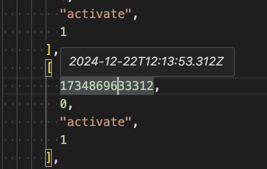

# Timestamp Hover

Display the ISO time and date while hovering over timestamps.

- Automatically converts timestamps from seconds or milliseconds to ISO Time.
- Does not convert timestamps before 1980 to avoid being noisy.

<!--- @@inject: ../../static/footer.md --->

 

---

Copyright © 2017-2026 Street Side Software

Brought to you by <a href="https://streetsidesoftware.com" title="Street Side Software">
 Street Side Software
</a>

<!--- @@inject-end: ../../static/footer.md --->
